  <picture>
    <source media="(prefers-color-scheme: dark)" srcset="./images/banner-dark.svg">
    <source media="(prefers-color-scheme: light)" srcset="./images/banner-light.svg">
    
  </picture>

  <b><i>"The net is vast and infinite."</i></b>

<h2 align="center">About Me</h2>

  💻 I'm <b>Daniel Macedo</b>, a backend-focused full-stack developer from São Paulo. 
  ⚙️ I build <b>REST APIs with Java + Spring Boot</b> and <b>web apps with TypeScript, React and Next.js</b>. 
  🐍 I also ship <b>Python</b> tools: FastAPI services and Streamlit data dashboards. 
  🧠 Currently learning <b>software architecture, Hibernate and AI-assisted development</b>. 
  🎮 Ask me about <b>tech, games or anime</b>.

<h2 align="center">Tech Stack</h2>

<b>Backend</b>

  <picture>
    <source media="(prefers-color-scheme: dark)" srcset="https://skillicons.dev/icons?i=java,spring,py,fastapi&theme=dark">
    
  </picture>

<b>Frontend</b>

  <picture>
    <source media="(prefers-color-scheme: dark)" srcset="https://skillicons.dev/icons?i=ts,react,nextjs,vite,tailwind,threejs&theme=dark">
    
  </picture>

<b>Databases &amp; Tools</b>

  <picture>
    <source media="(prefers-color-scheme: dark)" srcset="https://skillicons.dev/icons?i=postgres,mysql,mongodb,docker,git,githubactions,postman&theme=dark">
    
  </picture>

<b>Data &amp; Testing</b>

       

<h2 align="center">GitHub Overview</h2>

  <picture>
    <source media="(prefers-color-scheme: dark)" srcset="./profile/stats-dark.svg">
    
  </picture>
  <picture>
    <source media="(prefers-color-scheme: dark)" srcset="./profile/top-langs-dark.svg">
    
  </picture>

  <picture>
    <source media="(prefers-color-scheme: dark)" srcset="./profile/streak-dark.svg">
    
  </picture>

<h2 align="center">Contribution Graph</h2>

  <picture>
    <source media="(prefers-color-scheme: dark)" srcset="https://raw.githubusercontent.com/Daniel-Macedo-dev/Daniel-Macedo-dev/output/pacman-contribution-graph-dark.svg">
    
  </picture>

<h2 align="center">Contact</h2>

    

If you like it, fork 🍴 and star ⭐

<picture>
  <source media="(prefers-color-scheme: dark)" srcset="https://capsule-render.vercel.app/api?type=waving&color=0:000000,100:30363d&height=120&section=footer">
  
</picture>
